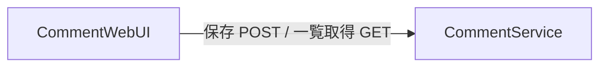

# コンポーネントカタログ — コメントボード Mock

要件（`inception/requirements-analysis/requirements.md`）と、確認質問 Q4 の「フロントエンド/バックエンドで分割」に基づき、論理的な構成要素を 2 つに分けた。DynamoDB・API Gateway・S3/CloudFront はコンポーネントの外部依存として扱う。

```yaml
components:
  - name: CommentWebUI
    summary: コメントの入力フォームと一覧表示を行うブラウザ上の Web ページ
    behaviour: >
      表示時と投稿成功時に CommentService の一覧取得 API を呼び、本文と保存時刻を新しい順に描画する。
      投稿ボタン押下で本文を保存 API に送信し、成功したら入力欄を空にして一覧を再取得する。
      送信前に空文字（空白のみ）と 500 文字超を検知してエラーを表示する（最終判定は CommentService）。
      API のエラー応答・通信失敗時は画面にエラーメッセージを表示する。
      本文は textContent で描画し、HTML として解釈させない（XSS 防止）。
    responsibilities:
      - 投稿フォーム（本文入力・投稿ボタン）の表示と入力受付
      - コメント一覧の取得と表示（新しい順）
      - 投稿・取得失敗時のエラーメッセージ表示
    depends_on:
      - component: CommentService
        interaction: コメントの保存（POST）と一覧取得（GET）
        style: sync
    dependents: []
    external_dependencies:
      - name: Amazon S3 + Amazon CloudFront
        kind: object-store
        purpose: 静的ファイル（HTML / JavaScript）の配信
    entities: []
  - name: CommentService
    summary: コメントの保存と一覧取得を提供するバックエンド API
    behaviour: >
      保存要求では本文を検証する（必須・空白のみ不可・500 文字以内）。不正なら HTTP 400 とエラーメッセージを返し保存しない。
      正常なら一意 ID（UUID）と保存時刻（UTC, ISO 8601）を付与して DynamoDB に保存し、HTTP 201 で保存内容を返す。
      一覧要求では全コメントを取得し保存時刻の新しい順に並べて HTTP 200 で返す（0 件は空配列）。
      DynamoDB 呼び出しの失敗はログに記録し HTTP 500 を返す。認証は行わない（Mock）。
      ブラウザから呼べるよう CORS を許可する。
    responsibilities:
      - 入力検証
      - Comment の生成（ID・保存時刻の付与）と永続化
      - Comment 一覧の取得と並べ替え
      - エラー応答とログ出力
    depends_on: []
    dependents:
      - component: CommentWebUI
        interaction: コメントの保存（POST）と一覧取得（GET）
    external_dependencies:
      - name: Amazon DynamoDB
        kind: database
        purpose: Comment の保存と取得
      - name: Amazon API Gateway
        kind: other
        purpose: HTTP エンドポイントの公開
    entities:
      - name: Comment
        identifier: id
        attributes: [id, body, createdAt]
```

## コンポーネント図



<!-- Text fallback: CommentWebUI が CommentService を同期 HTTP で呼び出し、コメントの保存と一覧取得を行う。 -->

## コンポーネント概要

| Component | Purpose | Depends On | Dependents | Entities Owned |
|---|---|---|---|---|
| CommentWebUI | 入力フォームと一覧表示の Web ページ | CommentService | なし | なし |
| CommentService | コメントの保存・一覧取得 API | なし | CommentWebUI | Comment |

## エンティティの所有

| Entity | Owning Component | Identifier | Attributes | References |
|---|---|---|---|---|
| Comment | CommentService | id | id, body, createdAt | なし |

## 外部依存

| Component | Dependency | Kind | Purpose |
|---|---|---|---|
| CommentWebUI | Amazon S3 + Amazon CloudFront | object-store | 静的ファイル配信 |
| CommentService | Amazon DynamoDB | database | Comment の保存・取得 |
| CommentService | Amazon API Gateway | other | HTTP エンドポイント公開 |

## 根拠

| Component | 別の構成要素にする理由 |
|---|---|
| CommentWebUI | ブラウザで動く表示ロジックで、実行環境・変更理由・担当者（UNIT1）がバックエンドと異なる |
| CommentService | データの所有者（Comment）であり、検証と永続化のビジネスルールを持つ。担当者（UNIT2）が異なる |

**Alternatives Rejected**: 投稿機能と一覧機能で縦に分割する案（確認質問 Q4 の B）は、Comment エンティティの所有者が 2 つに分かれてしまうため採用しない。CommentService を「API ハンドラー」と「リポジトリ」に細分する案は、Mock の規模では分割の利点がなく実装を遅くするため採用しない（コード内のモジュール分けで十分）。
